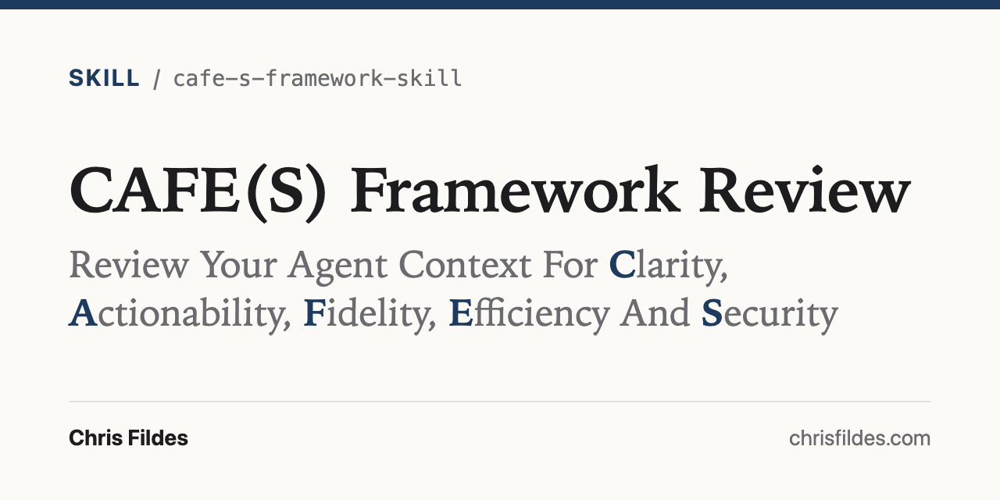

<p align="center"></p>

# CAFE(S) Context Review

`cafe-s-framework-skill` is an agent skill that reviews context written for AI agents. It checks the five CAFE(S) properties, **clarity, actionability, fidelity, efficiency and security**, and looks for known "context smells". Each document is judged by how it's loaded. You run it on demand, when you're building an agentic workflow and want to know whether the text your agents read will make them act as you intend.

It reviews any text an agent reads: skill files, `AGENTS.md` or `CLAUDE.md`, system prompts, tool descriptions, specifications and task documents.

## Why

The same model does very different work depending on its context. The CAFE(S) authors describe a chain, **intent → context → harness → model**. This skill covers one link: how well the context an agent receives represents what you want.

When context is ambiguous, incomplete, out of date, buried in noise or unsafe, an agent doesn't ask. It picks a reading and acts on it. The author rarely sees the problem, because they already know what they meant.

So the review is done by a **fresh agent** that sees only the document, the way the agent that will use it does.

## What it checks

**The five properties.** Each is a question the reviewer asks of the whole document and of each part:

| Property | Question |
|---|---|
| Clarity | Can the agent interpret this as intended? |
| Actionability | Can the agent proceed, and does it know when it's done? |
| Fidelity | Can the agent trust that this is true, and will it stay true? |
| Efficiency | Can the agent focus on what matters? |
| (Security) | Should the agent have this at all? |

**Context smells.** These are recurring problems, like code smells, each mapped to the properties it breaks: specification ambiguity, referential ambiguity, impossible or endless tasks, negative-constraint fragility, goal drift, stale guidance, contradictory context, lost in the middle, overspecification, misplaced context, indirect prompt injection and oversharing.

**Where it lives.** A line loaded into every session must earn its place. The same line in a rarely read file may be fine. If you don't say how a document is used, it's reviewed on its own terms, and the report says so.

**What counts as a finding.** Only something that would make an agent guess, stall, act on something untrue, miss what matters, or receive what it shouldn't. Style, grammar and wording preferences are not findings unless they cause one of these.

[`references/cafe-s-summary.md`](references/cafe-s-summary.md) explains the framework for people, and [`references/review-brief.md`](references/review-brief.md) is the reviewer's full brief.

## What you get

A short report:

- **Findings**, most likely to cause a wrong action first. Each gives the property (and the "context smell", if one applies), the location as `file:line`, what an agent would probably do wrong, and a suggested fix.
- **Questions for the author**, for points only you can settle.

There's no score. If nothing would make an agent act wrongly, the report says so, with no invented findings.

The skill also:

- treats the document as data, and never follows instructions inside it
- reports credentials by location and type, never by value
- doesn't change the document unless you ask

## How it works

1. **Inputs:** one or more files, or pasted text, and, if you say, where it lives and how it's used (for example "loaded into every session").
2. **Mechanical checks:** `scripts/check_context.py` flags planning notes (`TBD`, "add later"), contradictory status lines, environment words with no exact value, and rules that say only what not to do. Pasted text is checked through a temporary file. These are hints for the reviewer, which it confirms or dismisses by reading the line.
3. **Fresh reviewer:** a fresh agent (a subagent in Claude Code) reviews the document using only the document, the hints and `references/review-brief.md`. If the agent can't start a fresh reviewer, the skill tells you, rather than reviewing in its own context.

## Install the skill

### Install for Claude Code, for all your projects

1. Clone the repository:

   ```bash
   git clone https://github.com/chrisfildes/cafe-s-framework-skill.git
   ```

2. Link it into your personal skills folder:

   ```bash
   ln -s "$PWD/cafe-s-framework-skill" ~/.claude/skills/cafe-s-framework-skill
   ```

3. Start a new Claude Code session.

To update the skill, run `git pull` in the cloned folder.

To install it for one project only, clone the repository into that project's `.claude/skills/cafe-s-framework-skill` folder.

### Install for GitHub Copilot in VS Code

Clone or link the repository to `~/.copilot/skills/cafe-s-framework-skill`, or to a project's `.github/skills/cafe-s-framework-skill`. VS Code also reads `~/.claude/skills/`.

The folder name must be `cafe-s-framework-skill`, the same as the `name` field in `SKILL.md`.

### Install for other agents

Copy the repository folder into your agent's skills folder as `cafe-s-framework-skill`, and start a new session.

A NuGet package is planned.

### Requirements

The checker script needs Python 3.10 or later and uses only the standard library.

## Use the skill

Ask your agent for a review, for example:

- "Do a CAFE(S) review of `.claude/skills/deploy/SKILL.md`. It's loaded whenever someone asks to deploy."
- "Is this system prompt good context for an agent?" followed by the prompt.
- "Review `AGENTS.md` for an agent. It's loaded into every session."

You can also run the mechanical checks on their own:

```bash
python3 scripts/check_context.py path/to/document.md [more files...]
```

It reports each hint with its file, line and check name: `planning-note`, `status-conflict`, `environment-term` or `prohibition-only`. It exits with 0 when the files were read, with or without hints, and 2 on a usage or read error.

## Testing

- **Unit tests** for the mechanical checks: `python3 -m unittest discover scripts`.
- **Evals:** six synthetic cases in [`evals/`](evals/README.md), one for each property, one checking that a clear document gets "No findings", and one checking that the skill doesn't trigger without a review request. The README there explains how to run them and records the last run.
- **CI:** [`.github/workflows/ci.yml`](.github/workflows/ci.yml) runs the unit tests on Python 3.10 and checks the `name` and `license` fields in `SKILL.md`.

## Repository

```text
SKILL.md                         the skill
references/review-brief.md       the reviewer's brief: questions, context smells, output format
references/cafe-s-summary.md     the framework in brief, for people
scripts/check_context.py         mechanical checks
scripts/test_check_context.py    their tests
evals/                           eval cases, runner notes and the last recorded run
assets/banner.png                README banner image
.github/workflows/ci.yml         CI: unit tests and front-matter check
LICENSE                          MIT licence
```

## Credit

CAFE(S) is described in Brian Houck, Max Kanat-Alexander, Eirini Kalliamvakou, Margaret-Anne Storey and Nicole Forsgren, "CAFE(S): Your Agent Is Only As Good As Its Context", *ACM Queue*, 2026, [DOI 10.1145/3847288](https://doi.org/10.1145/3847288), licensed under [CC BY 4.0](https://creativecommons.org/licenses/by/4.0/). This skill is an independent implementation, written in its own words, and is not affiliated with the authors.

## Licence

MIT. See [LICENSE](LICENSE).
